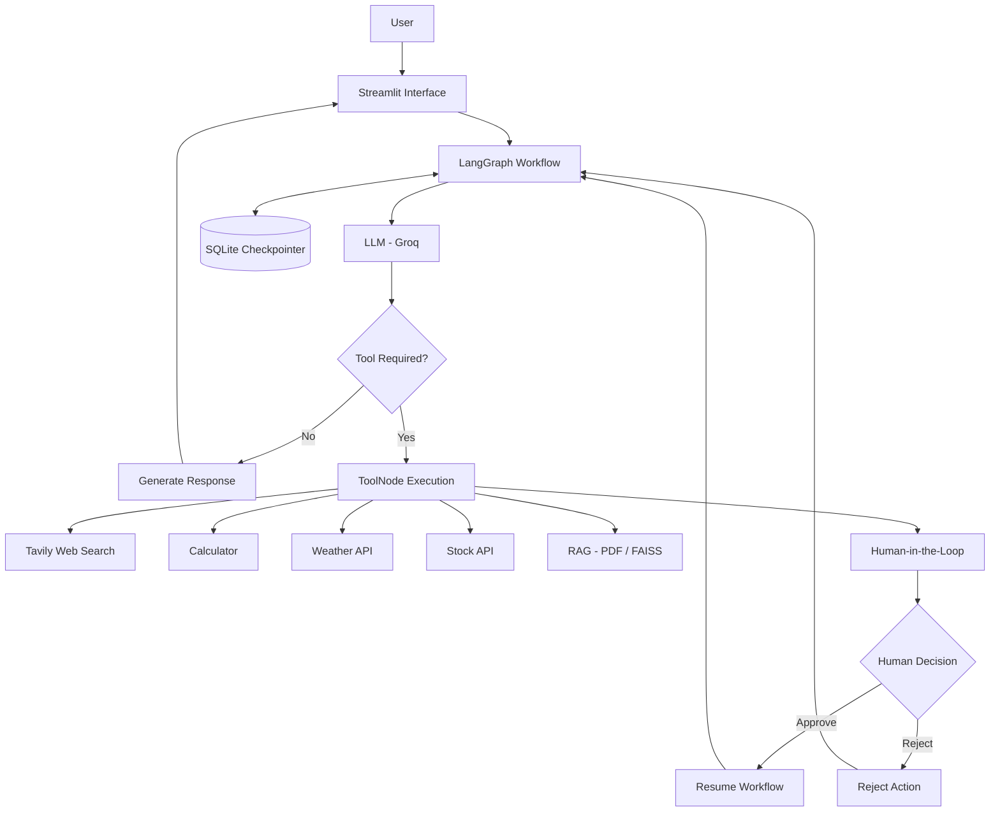
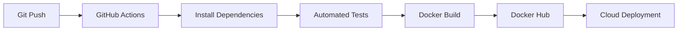

# 🤖 Agentic AI Chatbot

\<p align="center">
&#x20; \<strong>An intelligent AI assistant powered by LangGraph, LangChain, RAG and Human-in-the-Loop workflows.\</strong>
\</p>

\<p align="center">
&#x20; \
&#x20; \
&#x20; \
&#x20; \
&#x20; \
&#x20; \
\</p>

---

## 📌 Overview

**Agentic AI Chatbot** is an intelligent conversational application developed with Python, LangChain and LangGraph.

Unlike a traditional chatbot, the application can determine when to answer directly and when to invoke external tools to perform specific tasks.

It combines multiple AI capabilities, including tool calling, web search, Retrieval-Augmented Generation (RAG), persistent conversational memory and Human-in-the-Loop (HITL) workflows.

The application is delivered through a Streamlit interface and containerized with Docker, with an automated CI/CD workflow and cloud deployment.

## ✨ Key Features

### 🧠 1. Agentic AI & Tool Calling

The assistant uses an LLM connected to tools and orchestrated through LangGraph.

Available capabilities include:

| Tool                | Functionality                                            |
| ------------------- | -------------------------------------------------------- |
| Web Search          | Search for information using Tavily                      |
| Calculator          | Perform mathematical calculations                        |
| Weather             | Retrieve current weather information                     |
| Stock Price         | Retrieve stock market information                        |
| PDF RAG             | Retrieve relevant information from uploaded documents    |
| Purchase Simulation | Trigger a human approval workflow for a simulated action |

The LLM decides whether to respond directly or request tool execution.

### 📄 2. Retrieval-Augmented Generation (RAG)

The application supports question answering over PDF documents.

**RAG workflow:**

1. Upload a PDF document.
2. Extract text using PyPDFLoader.
3. Split the extracted content into chunks.
4. Generate vector embeddings using Google Generative AI Embeddings.
5. Store document vectors in FAISS.
6. Retrieve relevant document chunks based on the user's query.
7. Generate a contextual response using the retrieved information.

**Technologies:** LangChain, PyPDF, Google Generative AI Embeddings, FAISS.

### 👤 3. Human-in-the-Loop (HITL)

The application integrates human approval into the AI workflow using LangGraph interrupts.

**Workflow:**

1. The user requests a sensitive simulated action.
2. The AI invokes the corresponding tool.
3. LangGraph pauses execution.
4. The user reviews the requested action.
5. The user approves or rejects it.
6. The workflow resumes according to the human decision.

The stock purchase feature is a simulation and does not execute real financial transactions.

### 💾 4. Persistent Conversational Memory

LangGraph SQLite Checkpointer provides persistent conversation state.

Features include:

- Unique conversation thread IDs.
- Context preservation across messages.
- Independent conversation threads.
- Conversation recovery after application restarts.
- Resumption of interrupted workflows.

### 💬 5. Streamlit User Interface

The application provides an interactive interface with:

- Conversational chat.
- Conversation history.
- Multiple chat threads.
- PDF document upload.
- AI tool interactions.
- Human approval and rejection controls.

---

## 🏗️ System Architecture



---

## 🛠️ Technology Stack

| Category             | Technologies            |
| -------------------- | ----------------------- |
| Programming Language | Python                  |
| LLM Orchestration    | LangChain               |
| Agentic Workflow     | LangGraph               |
| LLM Provider         | Groq                    |
| Embeddings           | Google Generative AI    |
| Vector Store         | FAISS                   |
| Document Processing  | PyPDF                   |
| Web Search           | Tavily                  |
| Database             | SQLite                  |
| Frontend             | Streamlit               |
| Containerization     | Docker                  |
| CI/CD                | GitHub Actions          |
| Container Registry   | Docker Hub              |
| Cloud Platforms      | Microsoft Azure, Render |

---

## 📁 Project Structure

```text
Agentic_Chatbot/
│
├── .github/
│   └── workflows/
│       └── CI/CD workflow
│
├── agentic_chatbot_backend.py
├── app.py
├── ui_theme.py
│
├── Dockerfile
├── .dockerignore
├── .gitignore
├── requirements.txt
│
└── README.md
```

Runtime data such as SQLite databases and FAISS indexes may be generated separately, depending on application configuration.

---

## ⚙️ Installation and Setup

### 1. Clone the repository

```bash
git clone https://github.com/houssem670/Agentic_Chatbot.git

cd Agentic_Chatbot
```

### 2. Create a virtual environment

```bash
python -m venv venv
```

**Windows:**

```powershell
venv\Scripts\activate
```

**Linux / macOS:**

```bash
source venv/bin/activate
```

### 3. Install dependencies

```bash
python -m pip install --upgrade pip

pip install -r requirements.txt
```

### 4. Configure environment variables

Create a `.env` file in the project root.

Example:

```env
GROQ_API_KEY=your_groq_api_key
GOOGLE_API_KEY=your_google_api_key
TAVILY_API_KEY=your_tavily_api_key
OPENWEATHER_API_KEY=your_openweather_api_key
ALPHA_VANTAGE_API_KEY=your_alpha_vantage_api_key
```

Configure the API keys required by the tools enabled in your backend.

**Security:** Never commit your `.env` file or expose API credentials in your source code.

### 5. Run the application

```bash
streamlit run app.py
```

Open the local application:

```text
http://localhost:8501
```

---

## 🐳 Docker

The application uses Docker for containerization.

### Build the Docker image

```bash
docker build -t agentic-chatbot .
```

### Run the container

```bash
docker run -p 8501:8501 --env-file .env agentic-chatbot
```

Access the application at:

```text
http://localhost:8501
```

### Publish to Docker Hub

```bash
docker login

docker tag agentic-ai-chatbot YOUR_DOCKERHUB_USERNAME/agentic-chatbot:latest

docker push YOUR_DOCKERHUB_USERNAME/agentic-chatbot:latest
```

---

## 🔄 CI/CD Pipeline

GitHub Actions is integrated into the project to automate the application delivery workflow.

The CI/CD process covers the following stages:

1. Code changes are pushed to the GitHub repository.
2. GitHub Actions starts the configured workflow.
3. Dependencies are installed.
4. Automated tests are executed when configured.
5. A Docker image is built.
6. The image is published to Docker Hub.
7. The image is made available for cloud deployment.

### CI/CD Workflow



---

## ☁️ Cloud Deployment

The application has been deployed on two cloud platforms:

- **Microsoft Azure:** Container-based application deployment.
- **Render:** Application deployment and hosting.

The Docker-based workflow supports consistent application packaging across deployment environments.

Environment variables and persistent storage must be configured appropriately on each platform.

---

## 🧪 Application Validation

The main application capabilities have been manually tested.

| Feature              | Validation                        |
| -------------------- | --------------------------------- |
| General Conversation | Response generation               |
| Calculator           | Mathematical calculations         |
| Web Search           | Tavily search integration         |
| Weather              | Weather API integration           |
| Stock Price          | Stock data retrieval              |
| PDF RAG              | Document-based question answering |
| HITL Approval        | Workflow resumes after approval   |
| HITL Rejection       | Simulated action is rejected      |
| SQLite Persistence   | Conversation recovery             |
| Cloud Deployment     | Application accessibility         |

---

## 🔐 Security Considerations

- API credentials are managed through environment variables.
- Deployment credentials should be stored in GitHub Secrets.
- Sensitive files and local databases should not be committed.
- External API responses should be validated.
- Persistent storage should be configured for SQLite and FAISS data.
- Sensitive simulated actions require human approval.

---

## 🚀 Future Improvements

- Advanced multi-agent collaboration.
- Authentication and user management.
- Improved multi-document RAG management.
- Conversation summarization and context optimization.
- Automated security scanning with Trivy.
- Dependency vulnerability scanning.
- Application monitoring and observability.
- Expanded automated testing.

---

## 🎯 Skills Demonstrated

- Agentic AI Application Development
- LangChain & LangGraph
- LLM Integration and Tool Calling
- Retrieval-Augmented Generation (RAG)
- Human-in-the-Loop Workflows
- Vector Search and Embeddings
- Python Application Development
- Persistent State Management
- Docker Containerization
- CI/CD Automation
- Cloud Application Deployment
